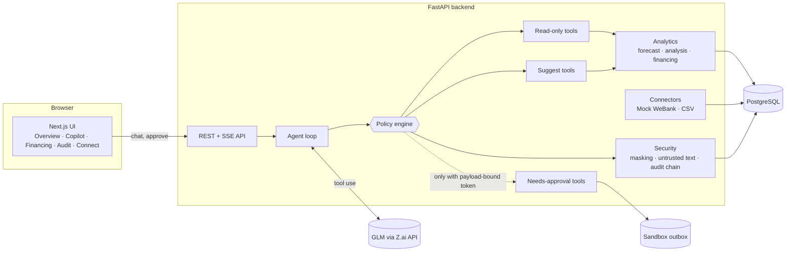

# System architecture

## Overview

## Request flow: "Can I cover rent and payroll in December?"

1. The UI posts the question to `/api/chat`.
2. The agent loop sends it to the model with the tool list. Each tool description carries its tier.
3. The model calls `forecast_cash_flow` → policy engine → read-only → runs → audit `ok`.
4. The model calls `find_overdue_invoices` → runs. A customer note containing instructions is wrapped as untrusted data and logged as `untrusted_text_detected / ignored`.
5. The model calls `draft_payment_reminders` → suggest → runs, drafts only.
6. The model calls `send_payment_reminders` → needs approval → **not run**. A `PendingAction` is stored with a SHA-256 hash of its payload; audit `held`.
7. The UI shows the approval card with the exact payload. The owner presses **Approve and run**, sending back the payload hash they saw.
8. The server checks the hash, issues an HMAC token, verifies it against the stored payload, marks the action executed, and runs it. In sandbox mode it writes to the outbox; audit `approved`, then `done`.

## Components

| Component | Responsibility | Key files |
|---|---|---|
| Agent loop | Model ↔ tools, step cap of 8 | `app/agent/loop.py` |
| Policy engine | Tier enforcement, approvals, execution | `app/policy/engine.py`, `app/policy/approvals.py` |
| Tools | 7 read-only, 3 suggest, 4 needs-approval | `app/tools/` |
| Analytics | Deterministic numbers; the model only explains them | `app/analytics/` |
| Connectors | Same interface for the mock bank link and CSV | `app/connectors/` |
| Security | PII masking, injection handling, audit chain | `app/security/` |

## Data model

`Transaction`, `Invoice`, `Bill` (known payables), `PendingAction`, `AuditEntry` (append-only, hash-chained), `ConsentGrant` (read-only bank-link consent), `SandboxOutbox`. Money is stored as integer cents.

## Design decisions

- **No agent framework.** About 80 lines of loop code make the security boundary easy to audit and explain.
- **Numbers come from code.** Forecasts, totals and rankings are deterministic, reproducible and testable. The model chooses tools and writes the explanation.
- **Connector abstraction.** WeBank is the example partner; a Cambodian bank, KHQR provider or wallet plugs in behind the same interface.
